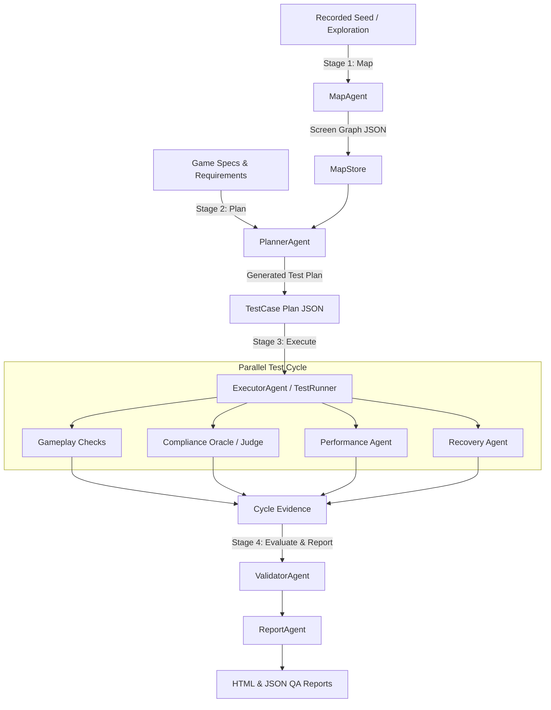

# 🎮 Netflix Game QA — Autonomous Agentic Testing Framework

[](https://www.python.org/)
[](https://www.anthropic.com/)
[](#supported-backends)
[](#-reinforcement-learning-rl-engine)
[](#-license)

An enterprise-grade, autonomous multi-agent testing framework for **Netflix Mobile Games** on Android & iOS. Powered by **Vision-Language Models (VLMs)**, graph-based navigation mapping, automated test planning, deterministic compliance verification, real-time performance sampling, and offline **Reinforcement Learning (Q-learning)** policies.

> 📍 **Zero Hardcoded Coordinates**: Every UI element, button, and gameplay object is located dynamically using natural language descriptions passed to the VLM.

---

## 🌟 Key Features

- 🧠 **Multi-Agent Orchestration**: Specialized agents handle screen exploration, test planning, execution, compliance evaluation, performance metrics, and recovery.
- 🗺️ **Autonomous Graph Mapping (Stage 1)**: Dynamically builds screen transition graphs (`MapStore`) with Dijkstra shortest-path navigation queries.
- 📋 **Automated Test Planning (Stage 2)**: Translates game specifications (`specs.py`) into executable `TestCase` plans mapped directly to graph routes.
- ⚡ **Multi-Backend Device Automation**: Supports native **ADB**, **Appium**, and high-FPS **scrcpy** streaming (for real-time endless runners).
- 🛡️ **Hybrid Compliance Checking**: Combines deterministic rule-based checking (`ComplianceOracle`) with AI verification (`VerificationJudge`) to prevent model hallucination.
- 🤖 **Offline Reinforcement Learning**: Formulates screen navigation as a Markov Decision Process (MDP) and trains tabular Q-learning policies offline for instant, zero-cost navigation.
- 🧩 **Extensible Game Plugin System**: Drop-in support for any game genre (*Tower Defense*, *Endless Runner*, *Sandbox/RPG*, *PvP*) with template-based expansion.
- 📊 **Rich HTML & JSON QA Reporting**: Comprehensive reports with per-check status (`PASS`/`FAIL`/`ERROR`/`PARTIAL`), evidence, and execution metrics.

---

## 🏗️ System Architecture

The pipeline operates in four decoupled stages:



---

## 🤖 Multi-Agent Ecosystem

| Agent | Subsystem | Responsibility |
|---|---|---|
| 🗺️ **`MapAgent`** | `src/agents/planning` | Builds `MapStore` screen graph via walkthrough seeds and gap exploration |
| 📋 **`PlannerAgent`** | `src/agents/planning` | Maps `build_requirements()` specs into optimal graph routes |
| ⚡ **`ExecutorAgent`** | `src/agents/execution` | Replays action sequences and executes gestures (tap, drag-and-drop, swipe) |
| 🛡️ **`ComplianceAgent`** | `src/agents/compliance` | Evaluates Netflix compliance rules via `ComplianceOracle` & `VerificationJudge` |
| 📈 **`PerformanceAgent`** | `src/agents/execution` | Samples real-time FPS, memory usage, and load times |
| 🩹 **`RecoveryAgent`** | `src/agents/execution` | Detects stuck loops or unexpected popups and self-heals |
| 👁️ **`VisionAgent`** | `src/agents/core` | Performs VLM scene perception, OCR, and element localization |
| 🎯 **`DecisionAgent`** | `src/agents/core` | High-level action selection during open-ended exploratory gameplay |
| 📊 **`ValidatorAgent`** | `src/agents/evaluation` | Consolidates evidence into authoritative pass/fail verdicts |
| 📑 **`ReportAgent`** | `src/agents/evaluation` | Generates standalone HTML QA dashboards and JSON summaries |

---

## 🎮 Game Support & Plugin Architecture

Games are structured as modular plugins under `src/games/`. Adding a new game requires zero core framework changes:

| Game | ID / Package | Plugin Path | Supported Features / Specs |
|---|---|---|---|
| **Bloons TD 6** | `bloons_td6` | `src/games/bloons_td6/` | Tower Defense placement, upgrading, target priorities, fast-forward |
| **Subway Surfers** | `subway_surfers` | `src/games/subway_surfers/` | Real-time CV lane perception, high-FPS scrcpy capture, reflex control |
| **Minecraft** | `minecraft` | `src/games/minecraft/` | World navigation, UI verification, cross-screen flow |
| **Custom Template** | `_template` | `src/games/_template/` | Starter template for adding any new mobile game |

### ➕ Adding a New Game (3 Steps)

1. **Create Plugin Directory**: `src/games/<your_game_id>/`
2. **Define Game Profile**: Create `profile.py` inheriting from `BaseGameProfile` and implement `build_requirements()` in `specs.py`.
3. **Register Game**: Export the profile in `src/games/registry.py`.

---

## 🚀 Quick Start

### 1. Prerequisites
- **Python 3.11+** installed
- **Android SDK / platform-tools (`adb`)** on system PATH
- **Anthropic API Key** (set via environment variable `LLM_API_KEY`)
- Connected Android device / emulator with USB debugging enabled

### 2. Installation

```bash
# Clone the repository
git clone https://github.com/Sinha28Shivam/Netflix_Agentic_Gameplay.git
cd NetflixGameTestHCL

# Create and activate virtual environment
python -m venv venv
source venv/bin/activate  # On Windows: venv\Scripts\activate

# Install core dependencies
pip install -r requirements.txt
```

#### *(Optional)* High-FPS Runner Backend Setup
For real-time endless runners like Subway Surfers:

```bash
pip install -r requirements-runner.txt
pip install --no-deps scrcpy-client==0.4.1
```

### 3. Environment Setup

Create a `.env` file in the root folder:

```env
LLM_API_KEY=your_anthropic_api_key_here
LLM_BASE_URL=https://api.anthropic.com/v1
VISION_MODEL=claude-opus-4-8
GAME_ID=bloons_td6
EXECUTION_MODE=adb
```

---

## 🛠️ Usage & Workflow

### Running the Full Pipeline

Execute setup (mapping & planning if not already built), the parallel test cycle, validation, and report generation:

```bash
python main.py
```

Force Mapper & Planner to re-run even if map cache exists:

```bash
python main.py --force-setup
```

### Running Individual Stages

```bash
python main.py --map      # Stage 1: Build screen navigation graph (data/maps/)
python main.py --plan     # Stage 2: Generate test plan (data/plans/)
python main.py --execute  # Stage 3: Run test plan on live device
python main.py --report   # Stage 4: Generate HTML report from results
```

### Modular Pipeline Scripts

```bash
# Map & Plan CLI (Seed graph from walkthrough log, explore gaps, generate plan)
python scripts/map_and_plan.py seed --game bloons_td6 --actions data/seeds/bloons_seed.json
python scripts/map_and_plan.py plan --game bloons_td6

# Run test plan directly
python scripts/run_plan.py --game bloons_td6

# Quick interactive gesture check (e.g. tower drag-and-drop)
python -m scripts.check_drag

# Fast I/O Benchmark (capture FPS & latency)
python -m scripts.bench_fast_io
```

---

## 🧠 Reinforcement Learning (RL) Engine

The framework contains a standalone tabular RL subsystem (`src/rl`) that converts screen graphs into Markov Decision Processes:

```bash
# 1. Train Q-learning policy offline from MapStore (0 device interaction, 0 API cost)
python -m src.rl.train --game bloons_td6 --episodes 5000

# 2. Drive live device navigation using trained Q-table
python scripts/rl_navigate.py --game bloons_td6
```

---

## 🧪 Testing

Run the comprehensive unit and integration test suite:

```bash
python -m pytest tests/ -v
```

The test suite covers:
- Map graph generation and Dijkstra routing (`test_map_and_plan.py`)
- Compliance oracle rules & judge gating (`test_compliance_split.py`)
- Test runner dispatch and result verification (`test_runner_dispatch.py`)
- Offline RL policy convergence (`test_rl.py`)
- Fast I/O perception contract (`test_subway_perception.py`, `test_drag_contract.py`)

---

## 📁 Project Structure

```
├── main.py                     # Primary pipeline entry point (--map, --plan, --execute, --report)
├── requirements.txt            # Main Python dependencies
├── requirements-runner.txt     # Optional scrcpy high-FPS dependencies
├── .env                        # Environment configuration
│
├── src/                        # Core Framework Package
│   ├── agents/                 # Multi-agent subsystems
│   │   ├── planning/           # MapAgent, PlannerAgent
│   │   ├── execution/          # ExecutorAgent, PerformanceAgent, RecoveryAgent
│   │   ├── compliance/         # ComplianceAgent, ComplianceOracle
│   │   ├── evaluation/         # ValidatorAgent, ReportAgent
│   │   └── core/               # VisionAgent, DecisionAgent
│   ├── core/                   # Central configuration & orchestration
│   │   ├── orchestrator.py     # Main QA cycle coordinator
│   │   ├── config.py           # Global settings & constants
│   │   └── engine/             # TestRunner, VerificationJudge
│   ├── device/                 # Hardware & automation primitives
│   │   ├── android/            # ADB utilities & screen capture
│   │   ├── appium_utils.py     # Appium fallback automation backend
│   │   └── fast_io.py          # High-FPS scrcpy video stream parser
│   ├── games/                  # Game Plugin Registry & Specifications
│   │   ├── bloons_td6/         # Bloons TD 6 plugin implementation
│   │   ├── subway_surfers/     # Subway Surfers plugin implementation
│   │   ├── minecraft/          # Minecraft plugin implementation
│   │   └── _template/          # Blueprint template for new games
│   ├── models/                 # Shared data structures, MapStore graph
│   └── rl/                     # Tabular Q-learning MDP environment & training
│
├── scripts/                    # Command-line utility scripts
│   ├── map_and_plan.py         # Standalone map seeding & planning CLI
│   ├── run_plan.py             # Test plan runner entry point
│   ├── rl_navigate.py          # RL policy execution driver
│   ├── check_drag.py           # Gesture calibration script
│   └── bench_fast_io.py        # Frame rate & latency benchmark
│
├── data/                       # Persistent seeds, maps, and plans
│   ├── maps/                   # Generated MapStore screen graphs (JSON)
│   ├── plans/                  # Generated game test plans (JSON)
│   └── seeds/                  # Seed walkthrough logs & requirement specs
│
├── outputs/                    # Execution artifacts & reports
│   ├── reports/                # Final HTML QA dashboards
│   └── results/                # Cycle execution results (JSON)
│
├── tests/                      # Pytest automated test suite
└── docs/                       # Detailed subsystem & architecture docs
```

---

## 📜 Documentation

For full architectural details, subsystem deep-dives, and API contracts, refer to the documentation:
- 📖 [Technical Architecture Index](docs/code_documentation/INDEX.md)
- 🏗️ [Architecture Overview](docs/code_documentation/01_architecture_overview.md)
- 🤖 [Agents Subsystem Guide](docs/code_documentation/02_agents_subsystem.md)
- 🧠 [Reinforcement Learning Guide](docs/REINFORCEMENT_LEARNING.md)
- ➕ [Adding a New Game Plugin](docs/ADDING_A_GAME.md)

---

## 📄 License

This project is released under the [MIT License](LICENSE).
